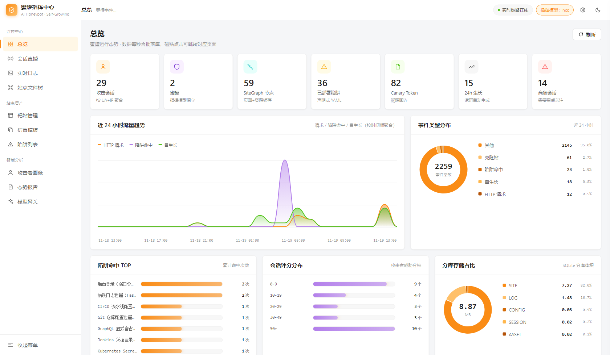
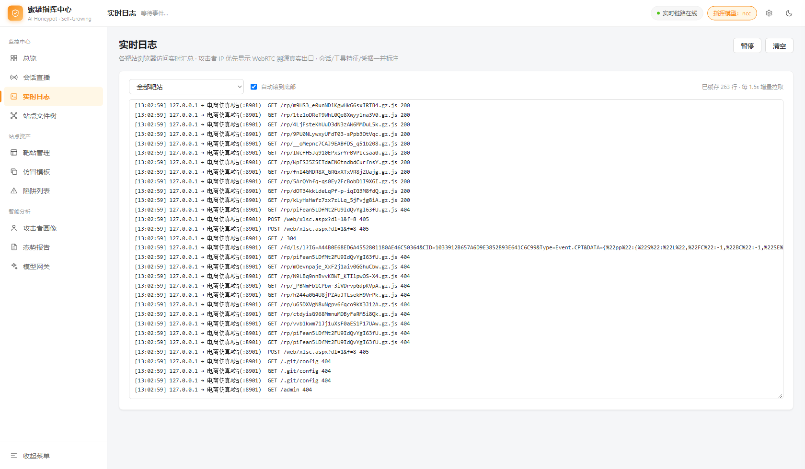
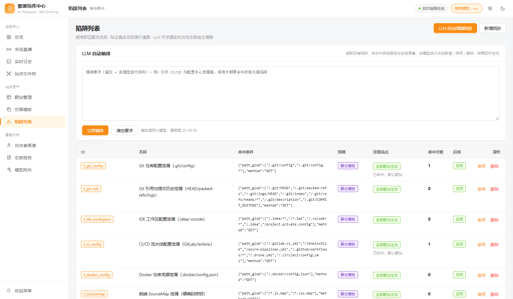
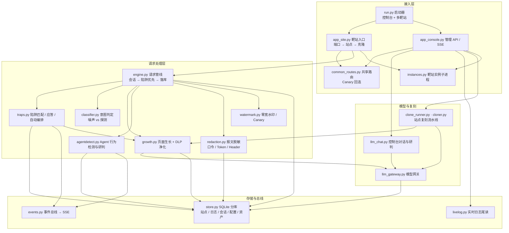

# 幻境 · AI 自生长交互式蜜罐

根据攻击者的实时行为自动生成并演化站点，把静态诱饵变成会随攻击者动作持续生长的靶场进行长时间牵制：探路径就造页面，试登录就给假后台，越深入诱饵越多；同时用陷阱规则库、WebRTC 溯源与 Canary 回连留存完整攻击证据。

控制台与靶站双端分离，全部能力通过 Web 界面操作，无需命令行。


---

## 功能

### 1. 站点自生长

攻击者访问未命中的路径时，系统判断意图后即时生成对应页面：目录扫描返回拟真目录列表，探测 `/admin` 生成带用户列表的后台，试登录则交出会"登录成功"的假后台。

- 规则引擎同步应答，模型生成在后台任务执行，**攻击者不会等待模型**
- 生成产物写入 SiteGraph，相同路径后续直接命中缓存，不重复调用模型
- 每小时生长配额 + 调用预算熔断，防止额度耗尽
- 模型不可用时降级为确定性模板，功能不中断

### 2. 指挥靶站变形（对话式）

在控制台对话框里用自然语言描述期望的变形方向，LLM自动修改靶站文件：

> 生成一个假后台，带 20 条用户列表、导出按钮和登录入口

支持多轮对话修订、实时查看生成过程、随时暂停人工干预。生成结果写入站点结构并自动注册路由。

### 3. 一键复刻真实站点

输入目标地址，流水线自动完成五步：

| 阶段 | 内容 |
| --- | --- |
| 下载 | 抓取首页与同源静态资源，改写为本地引用 |
| 分析 | 从表单、fetch、URL 中机械抽取接口清单 |
| 生成 | 按清单生成可运行的 FastAPI 后端；登录接口记录凭据后返回成功 |
| 自检 | 静态检查代码完整性，问题回喂模型修正一轮 |
| 部署 | 产出完整前后端模板，可挂载为独立靶站 |

模板挂载时整体复制为独立实例：独立进程、独立日志、独立文件系统，多靶站数据完全隔离。

### 4. 陷阱库与 LLM 自动编排

内置数十条贴近真实攻防的陷阱：`.git/config` 泄漏、IDE 工作区配置、CI/CD 凭据、Swagger 未脱敏文档、Docker/K8s 配置、数据库备份、弱口令 → MFA → 后台的完整认证链等。

- 陷阱对全部启用靶站生效，列表顺序即匹配优先级
- 支持手工新增（自定义正文 / 正则匹配）、启停、删除、命中演练
- LLM 可依据现有规则与近期未命中的探测路径自动编排增删
- 命中记录凭据、回连地址与命中计数
- Agent 观测诱饵覆盖候选客户端标记、隔离语义任务与合成状态 API；标记命中仅作低置信度线索，不执行命令、不连接其他主机

### 5. 攻击者溯源

| 手段 | 获取内容 |
| --- | --- |
| HTTP 来源 | 会话首个请求的对端 IP |
| WebRTC 溯源 | 真实公网出口 + 内网地址（穿代理） |
| Canary Token | 陷阱响应内注入回连地址，访问即告警 |
| 零宽水印 | 内容被复制后仍可回溯来源会话 |

控制台优先展示 WebRTC 结果并标注来源；脚本被禁用的自动化工具自动回退为 HTTP IP。

### 6. 实时日志

单一大文本框实时滚动各靶站访问记录，一眼看出攻击者踩了哪个页面：

```
[12:17:16] 117.152.77.40(WebRTC真实IP) → 默认靶站(:8888)  GET /ip 200  |  浏览器 · 会话 fa602bf1
[12:15:09] 117.152.77.40(WebRTC真实IP) → 默认靶站(:8888)  POST /admin/login 200  |  凭据提交 username=admin
```

支持按靶站过滤、暂停、清空、自动滚屏。引擎模式读数据库增量，实例模式尾读进程日志，两类靶站统一呈现。

### 7. 会话直播

SSE 驱动的双栏对话框：左栏跟踪站点复刻流水线，右栏指挥指定靶站自生长；下方为全局事件流。两个对话框绑定独立会话键，互不干扰。

### 8. 攻击者画像与态势报告

按会话汇总 IP、User-Agent、工具特征、风险评分、所处阶段、首次出现与最后活跃时间，支持关键词检索、单会话 LLM 研判、完整日志导出（JSON 缩进 / CSV）。态势报告可对指定时间窗生成结构化研判。

### 9. 模型网关

多 Provider 管理（地址、模型、Key、采样温度），支持单个探活与并发探活全部，可指定指挥模型；任一 Provider 故障自动重试并切换，全部不可用时降级。

---

## 控制台







| 分组 | 页面 | 能力 |
| --- | --- | --- |
| 监控中心 | 总览 | 会话、靶站、SiteGraph 节点、陷阱、Canary 统计与趋势分布 |
| | 会话直播 | 双栏 SSE 对话框 + 全局事件流 |
| | 实时日志 | 全靶站访问流，含溯源 IP、工具、会话 |
| | 站点文件树 | SiteGraph 还原目录树，查看源码与生成来源 |
| 站点资产 | 靶站管理 | 端口即入口，挂载 2 秒生效，支持预览/编辑/导出/删除 |
| | 仿冒模板 | 一键复刻，实时监督流水线进度 |
| | 陷阱列表 | 规则管理、命中分布、自动编排、命中演练 |
| 智能分析 | 攻击者画像 | 会话画像、模型研判、日志导出 |
| | 态势报告 | 时间窗行为研判报告 |
| | 模型网关 | Provider 配置与探活、指定指挥模型 |

---

## 快速开始

```bash
cd sec-tools/ai-honeypot
pip install -r requirements.txt
python run.py
```

打开 `http://127.0.0.1:9000/` 进入控制台。首次启动自动创建默认仿冒模板与默认靶站（8888）。

配置顺序：**模型网关**配置 Provider → **仿冒模板**复刻站点 → **靶站管理**挂载端口 → 浏览器访问该端口 → 在**实时日志**与**站点文件树**观察生长结果。

未配置任何模型时系统仍可运行，生长与复刻自动走离线确定性模板（页面丰富度下降）。

---

## 工作原理

```
攻击者请求
   │
   ├─ 1. 陷阱命中？        → 陷阱应答（同步，微秒级）
   ├─ 2. SiteGraph 有？    → 已固化页面 / 资源
   ├─ 3. 静态资源？        → 回源代理（不参与生长）
   └─ 4. 均未命中          → 意图判定
                              ├─ 噪声 → 404（不消耗模型额度）
                              └─ 探测/人工 → 计分 → 生长 → 返回新页面
   │
   └─ 全量请求落库（报文脱敏）→ 会话画像 / Agent 行为研判 / 实时日志 / 导出 / LLM 研判
```

静态资源单独回源，避免资源请求被误判为页面请求并生成 HTML 覆盖，导致前端脚本失效。

---

## 关键实现

**实时与生成解耦**：规则引擎同步应答，模型在后台生成；生成物写入 SiteGraph 后命中缓存。

**内容净化**：所有 LLM 产物落盘前经 DLP 扫描（替换邮箱、手机号、IP）与 HTML 实体归一化。`<script>` 内容不解码实体，若模型输出 `{&quot;key&quot;:...}` 会导致前端 `JSON.parse` 失败并把实体当文本显示，因此在落盘前统一还原。落盘路径同样净化，拒绝目录穿越与非法文件名。

**分库存储**：站点、日志、会话、配置、资产分库，各库独立锁；会话状态与计数走内存缓存，写操作后台批量落库，避免高并发下全局锁串行阻塞。列表接口默认返回轻量字段，仅导出时读取完整正文。

**事件总线**：主题化发布，`publish` 带短周期微聚合，`broadcast` 即时下发；控制台经 `/sse/stream` 单连接订阅，前端多消费者复用。

---
## 整体架构


## 目录结构

```
ai-honeypot/
├── run.py                    启动：控制台 + 多靶站监听管理
├── requirements.txt
├── config/traps.yaml         陷阱规则（顺序即优先级）
├── console/static/           控制台前端（Vue 3 单页）
├── honeypot/
│   ├── app_console.py        控制台入口与管理 API
│   ├── app_site.py           靶站入口
│   ├── common_routes.py      控制台/靶站共享路由（Canary 回连）
│   ├── engine.py             请求主链路
│   ├── traps.py              陷阱匹配 / 应答策略 / 自动编排
│   ├── classifier.py         意图判定（噪声 / 探测）
│   ├── growth.py             页面生长与离线降级
│   ├── agentdetect.py        Agent 行为检测与研判
│   ├── redaction.py          报文脱敏（口令 / Token / Header）
│   ├── clone_runner.py       复刻任务编排
│   ├── cloner.py             复刻流水线与模板变形
│   ├── instances.py          靶站实例与文件管理
│   ├── livelog.py            实时日志尾读
│   ├── llm_chat.py           控制台对话与研判
│   ├── llm_gateway.py        模型网关
│   ├── store.py              分库存储
│   ├── events.py             事件总线
│   ├── config.py             环境变量与阈值配置
│   └── watermark.py          零宽水印与 Canary
├── asset/                    README 截图
├── tests/
└── data/
    ├── hp_site.db            站点 / 模板 / SiteGraph
    ├── hp_log.db             请求数据包
    ├── hp_session.db         会话画像
    ├── hp_config.db          配置 / Provider / 陷阱
    ├── hp_asset.db           Canary 与资产
    ├── sites/                复刻模板（frontend + backend + site.json）
    └── instances/            靶站实例
```

---

## 配置

| 变量 | 默认值 | 说明 |
| --- | --- | --- |
| `HP_PERSONA` | `默认仿冒模板` | 站点人设，生长与复刻的默认品牌 |
| `HP_SITE_PORT` | `8888` | 靶站监听端口 |
| `HP_SITE_HOST` | `0.0.0.0` | 靶站绑定地址；生产由隔离网络/反向代理控制暴露 |
| `HP_CONSOLE_PORT` | `9000` | 控制台端口 |
| `HP_CONSOLE_HOST` | `127.0.0.1` | 管理端绑定地址，默认仅本机可访问 |
| `HP_CALLBACK_BASE` | `http://127.0.0.1:9000` | Canary 回连基地址 |
| `HP_GROWTH_QUOTA` | `20` | 每小时生长配额 |
| `HP_WEBRTC_ATTRIBUTION` | `false` | 是否启用浏览器 WebRTC 溯源（会访问外部 STUN，默认关闭） |

---

## 主要接口

| 方法 | 路径 | 说明 |
| --- | --- | --- |
| GET | `/api/overview` | 总览统计 |
| GET | `/api/charts` | 图表数据 |
| GET | `/api/storage` | 分库存储占用 |
| GET | `/api/sessions` | 会话画像列表 |
| POST | `/api/profile/{sid}/analyze` | 单会话 LLM 研判 |
| GET | `/api/packets` | 数据包列表（轻量） |
| GET | `/api/packets/credentials` | 凭据提交记录 |
| GET | `/api/logs/export` | 日志导出（JSON 缩进 / CSV） |
| GET | `/api/live/logs` | 实时日志增量 |
| GET / POST | `/api/sites` | 靶站列表 / 创建挂载 |
| PUT / DELETE | `/api/sites/{sid}` | 修改 / 删除靶站 |
| GET | `/api/instances` | 实例状态 |
| GET / PUT / DELETE | `/api/instances/{sid}/file` | 实例文件读写与删除 |
| POST | `/api/instances/{sid}/command` | 指挥靶站自生长 |
| POST | `/api/instances/{sid}/evolve` | 触发态势进化 |
| GET | `/api/sitegraph/{cid}` | 站点结构节点 |
| GET / POST | `/api/clones` | 模板列表 / 启动复刻 |
| POST | `/api/clones/{cid}/command` | 指挥复刻任务 |
| POST | `/api/clones/{cid}/pause` | 暂停复刻任务 |
| POST | `/api/morph/{cid}/chat` | 指挥模板变形（SSE） |
| GET / POST | `/api/traps` | 陷阱列表 / 新增 |
| PUT / DELETE | `/api/traps/{tid}` | 修改 / 删除陷阱 |
| POST | `/api/traps/auto` | LLM 自动编排 |
| POST | `/api/traps/{tid}/dryrun` | 命中演练 |
| GET | `/api/llm/providers` | Provider 列表 |
| POST | `/api/llm/providers/{pid}/test` | 单 Provider 探活 |
| POST | `/api/llm/providers/test-all` | 并发探活全部 |
| PUT | `/api/llm/commander` | 指定指挥模型 |
| POST | `/api/reports/generate` | 生成态势报告 |
| GET | `/sse/stream` | 全局事件流（SSE） |

---

## 已知限制

- SQLite 单机存储，未做多节点共享；横向扩展需替换存储层
- 靶站实例为独立子进程，数量受本机端口与进程数限制
- 生长质量依赖指挥模型稳定性，模型不可用时降级为确定性模板
- WebRTC 溯源依赖攻击者浏览器执行页面脚本，纯命令行工具无法获取
- 控制台未内置鉴权；默认绑定回环地址，任何反向代理暴露前必须配置企业身份认证、授权和审计
- 运行时生成的实例后端目前以本机子进程运行，未实现 OS/容器级沙箱，不满足不可信代码隔离要求

---

## 安全与合规

本系统用于**经授权的**安全测试与防守演练。

- 复刻目标站点前须取得授权
- 靶站刻意暴露看似可利用的路径与弱入口，不应部署在不受控的公网环境
- 采集的凭据、IP、会话内容属敏感数据，默认仅存储于本地 `data/`，处理方式须符合适用法规与组织合规要求